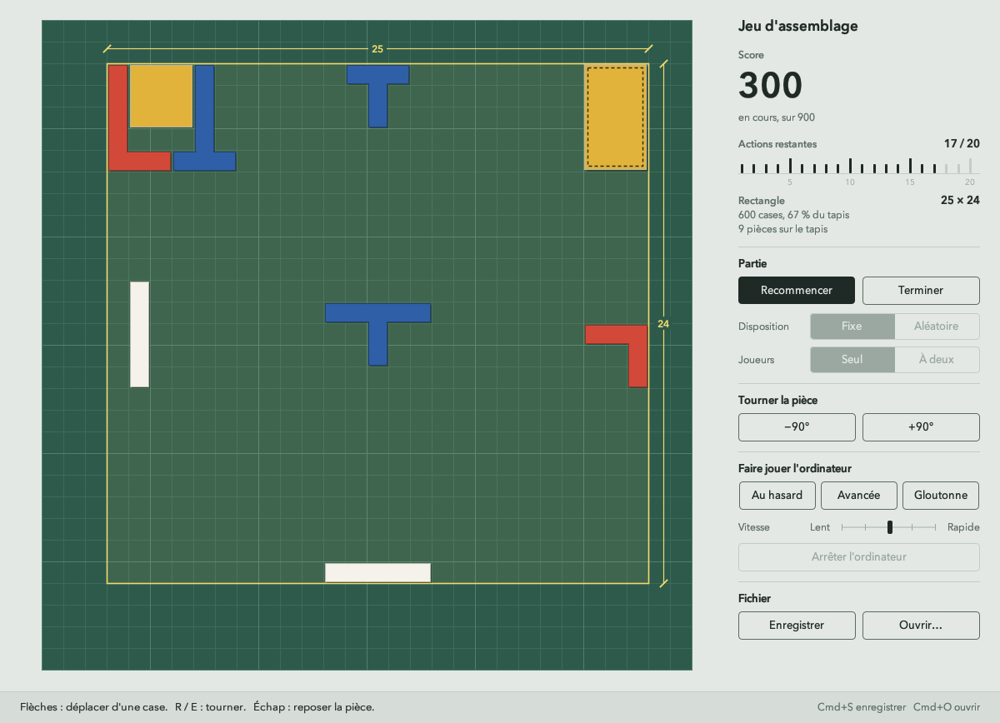
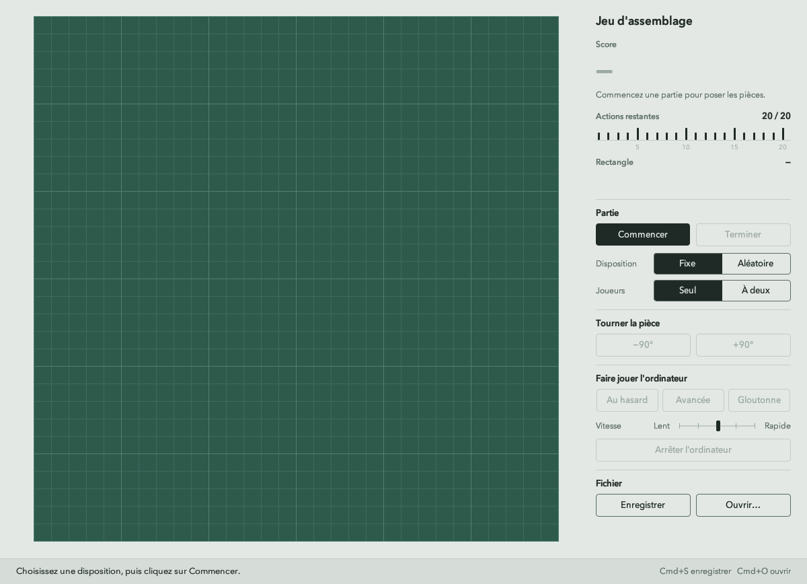
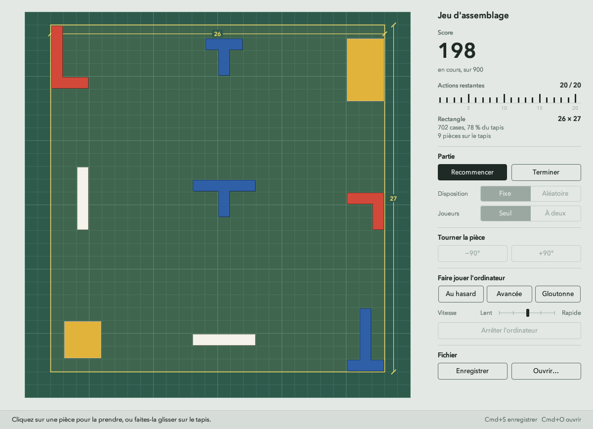
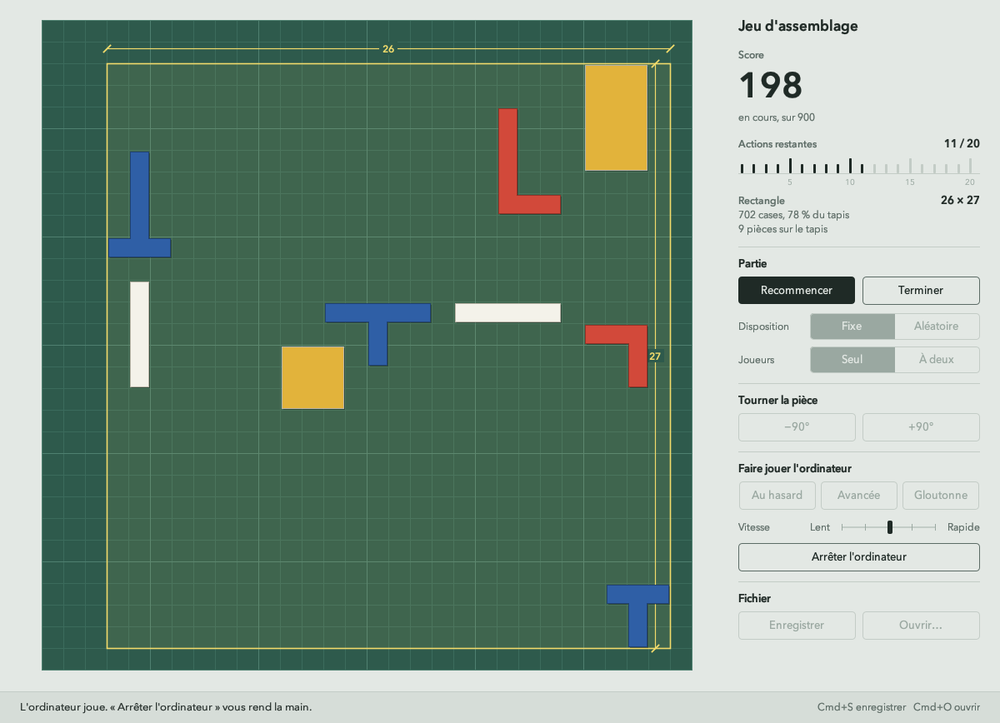
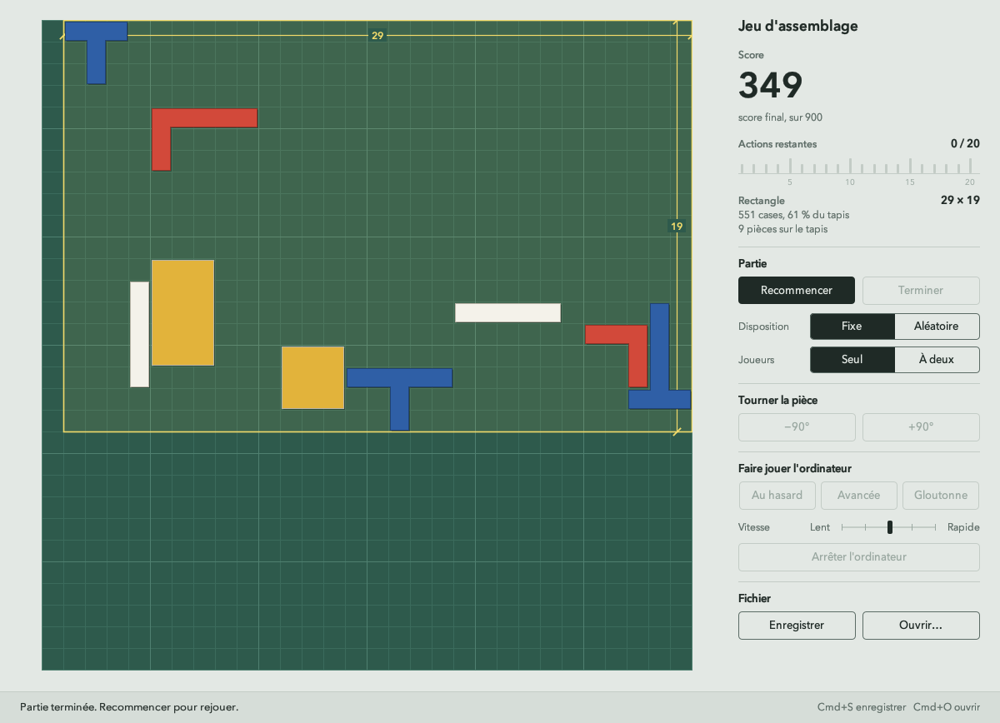
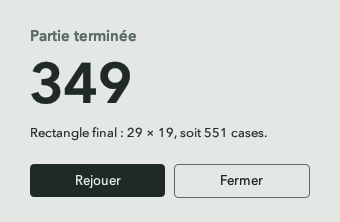
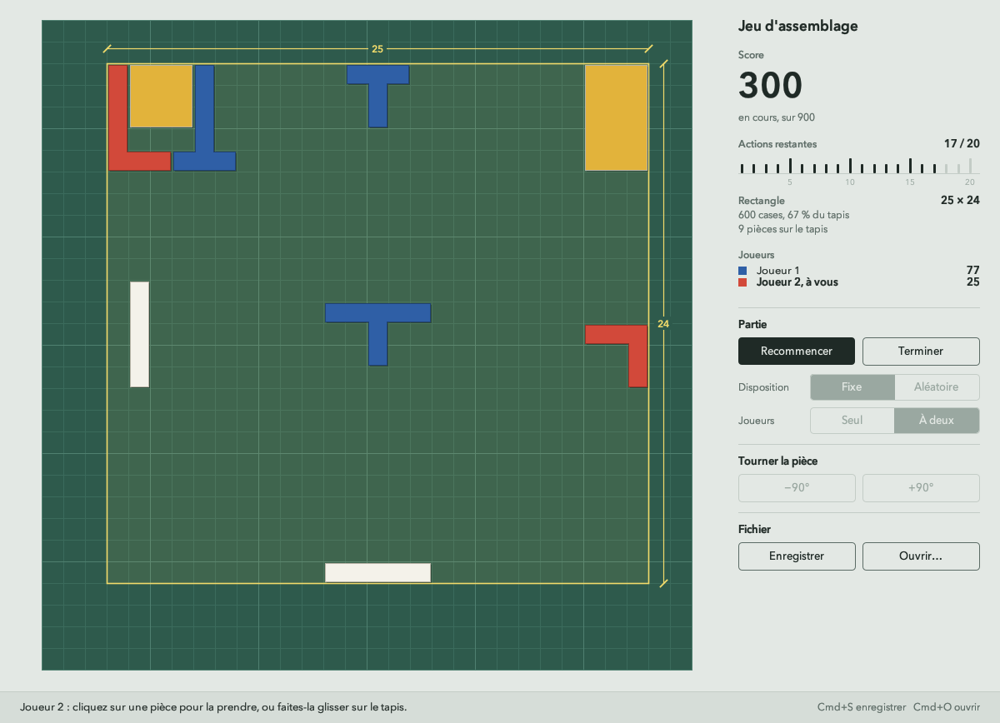

# Jeu d'assemblage — a shape-packing puzzle in Java Swing

[](.github/workflows/ci.yml)


A puzzle game where the player has a limited number of actions to **pack a set of
pieces into the smallest possible rectangle**. It was built for the *Méthodes de
conception* (software design) course at the Université de Caen Normandie. The point
of the project is a clean, modular architecture: MVC, Observer, Strategy, Factory,
Chain of Responsibility and Template Method.

The user interface is in **French** (it was a French university project). Every
label is translated in this document.



---

## Table of contents

1. [How the game works](#1-how-the-game-works)
2. [Interface tour](#2-interface-tour)
3. [Controls and keyboard shortcuts](#3-controls-and-keyboard-shortcuts)
4. [Artificial intelligences](#4-artificial-intelligences)
5. [Two-player mode](#5-two-player-mode)
6. [Saving and loading](#6-saving-and-loading)
7. [Console version](#7-console-version)
8. [Building and running](#8-building-and-running)
9. [Tests and continuous integration](#9-tests-and-continuous-integration)
10. [Architecture](#10-architecture)
11. [Design patterns](#11-design-patterns)
12. [Configuration](#12-configuration)
13. [Legacy Ant build](#13-legacy-ant-build)
14. [License](#14-license)

---

## 1. How the game works

### The board and the pieces

The game is played on a **30 × 30 grid**. The interface draws it as a green cutting
mat, with a stronger line every five cells so distances are easy to count. When the
game starts, pieces are placed on the mat. They come in four shapes, each drawn as a
card cut-out of its own colour:

| Shape | Colour | Description |
|-------|--------|-------------|
| **L** | vermilion red | an L-shaped piece (one full column plus a foot) |
| **T** | cobalt blue   | a T-shaped piece (a full bar plus a stem in the middle) |
| **R** | mustard yellow | a full **R**ectangle |
| **I** | off-white     | a straight bar, one cell wide |

Each piece has a base width and height (3 or 5 cells; the `I` bar is 1 cell wide)
and one of four orientations (north, east, south, west).

There are two ways to place the pieces at the start (the **Disposition** setting):

* **Fixe** (*fixed*): a hand-picked set of pieces spread over the board. Every game
  starts the same way, so scores can be compared.
* **Aléatoire** (*random*): random pieces generated by `PieceFactory` and dropped at
  random free positions.

### Actions

The player has **20 actions** (`GameConfig.MAX_ACTIONS`). An action is one of:

* **moving** a piece to another position, or
* **rotating** a piece by 90° clockwise or anticlockwise.

An action counts only if it is **legal**: the piece must stay inside the board and
must not overlap another piece. An illegal action is rejected and **costs nothing**.

### Score

All the pieces together define a **bounding rectangle**, the smallest rectangle that
contains every occupied cell. The interface draws it in yellow like a dimension on a
technical drawing: a frame, plus a width line above it and a height line on its
right, each labelled with its length in cells.

```
score = board area − bounding rectangle area
      = 30 × 30   − (width × height of the bounding rectangle)
```

The tighter you pack the pieces, the smaller the rectangle and the **higher** the
score. The game ends when all 20 actions are used, or when you press **Terminer**
(*end*).

> Example: if the pieces fit in an 18 × 20 rectangle, the score is
> 900 − 360 = **540**.

---

## 2. Interface tour

The window has three areas:

* the **mat** on the left, where the pieces are;
* the **control column** on the right: the readouts at the top, then the controls
  grouped by what they act on (*Partie*, *Tourner la pièce*, *Faire jouer
  l'ordinateur*, *Fichier*);
* the **status bar** at the bottom. Its left side always says, in one sentence, what
  you can do right now. Its right side reminds you of the save and open shortcuts.

The mat keeps square cells and stays centred when the window is resized. If the
window is too short for the column, the column scrolls.

### 2.1 Start screen



When the application opens, the mat is empty and the score reads `—`. The status
bar says *« Choisissez une disposition, puis cliquez sur Commencer. »* ("Choose a
layout, then click Start.").

The controls, from top to bottom:

| Group | Label (French) | Meaning | What it does |
|---|---|---|---|
| Partie | **Commencer** / **Recommencer** | Start / Restart | Places the pieces and starts a new game. After the first game it reads *Recommencer*. |
| Partie | **Terminer** | End | Stops the game now and computes the final score. |
| Partie | **Disposition**: *Fixe* / *Aléatoire* | Layout: fixed / random | Chooses how the pieces are placed. Locked during a game. |
| Partie | **Joueurs**: *Seul* / *À deux* | Players: alone / two players | Turns hot-seat mode on or off ([§5](#5-two-player-mode)). Locked during a game. |
| Tourner la pièce | **−90°** / **+90°** | Rotate the piece anticlockwise / clockwise | Rotates the selected piece. |
| Faire jouer l'ordinateur | **Au hasard** | At random | Lets the random AI play the remaining actions. |
| Faire jouer l'ordinateur | **Avancée** | Advanced | Lets the sampling AI play. |
| Faire jouer l'ordinateur | **Gloutonne** | Greedy | Lets the hill-climbing AI play. |
| Faire jouer l'ordinateur | **Vitesse**: *Lent* … *Rapide* | Speed: slow … fast | Delay between two AI moves, from 2 s to 0.1 s. |
| Faire jouer l'ordinateur | **Arrêter l'ordinateur** | Stop the computer | Stops the AI after its current move; you can then go on playing. |
| Fichier | **Enregistrer** | Save | Saves the current game to a `.json` file. |
| Fichier | **Ouvrir…** | Open | Loads a saved game. |

The one dark button is the main action (*Commencer*). The others are outlined. A
control is greyed out whenever its action is not possible: the rotate buttons stay
disabled until a piece is selected, and the *Disposition* and *Joueurs* choices are
locked during a game.

### 2.2 A game in progress



Once the game has started:

* The **yellow dimension** on the mat is the bounding rectangle, the quantity you
  want to shrink. Its two numbers are its width and height in cells. It is redrawn
  after every action.
* The readouts at the top of the column show:
  * **Score**: the live score in large type, with *en cours, sur 900* ("in
    progress, out of 900") under it.
  * **Actions restantes** (*actions left*): `n / 20`, and a ruler with one notch
    per action. The notches you have used turn pale. When 5 or fewer are left,
    the remaining notches and the count turn red.
  * **Rectangle**: the size of the bounding rectangle (`width × height`), its area
    in cells (*cases*) and as a share of the mat (*du tapis*), and the number of
    pieces on the mat.

### 2.3 Selecting and moving a piece


* **Click** a piece to pick it up. It lifts slightly off the mat (its shadow gets
  deeper) and a **dashed line** appears just inside its edge, like a scored line on
  card. In the screenshot, the yellow rectangle at the top right is selected.
* The rotate buttons become available and the status bar lists the keyboard
  controls: *« Flèches : déplacer d'une case. R / E : tourner. Échap : reposer la
  pièce. »* ("Arrows: move one cell. R / E: rotate. Esc: put the piece down.").
* **Drag** a piece with the mouse to move it. It snaps to the grid when you release
  it. If the drop is illegal (outside the board or on another piece), the piece
  goes back to where it was and no action is used.

In this screenshot three actions have been played (*17 / 20* on the ruler). The
rectangle went down from 26 × 27 (702 cells) to 25 × 24 (600 cells), so the score
went up from 198 to 300.

### 2.4 Letting an AI play



When the computer is playing:

* the mat is **locked** (no mouse input) and the controls meant for a human are
  disabled, including saving and opening;
* **Arrêter l'ordinateur** (*stop the computer*) becomes available, and the status
  bar says so;
* the speed slider can be changed at any time, even while the AI is playing;
* the AI runs on a **background thread**, so the window stays responsive, but each
  move is applied on the Swing event thread, so the display never shows a
  half-updated board.

In the screenshot the advanced AI has already brought the rectangle down to 22 × 15
(330 cells, 37 % of the mat) with 11 actions left.

### 2.5 End of the game

| Final board | Final dialog |
|---|---|
|  |  |

When the last action is used, or when you click **Terminer**, the score is frozen
(the note under it becomes *score final, sur 900*), every notch of the ruler is
spent, and a dialog appears **once**. It shows *Partie terminée* (*game over*), the
final score, and the size of the final rectangle, for example *« Rectangle final :
29 × 14, soit 406 cases. »* ("Final rectangle: 29 × 14, that is 406 cells.").
**Rejouer** (*play again*) starts a new game straight away; **Fermer** (*close*)
leaves the final board on screen. In two-player mode the dialog names the winner
instead (see [§5](#5-two-player-mode)).

### 2.6 Two-player mode



With **Joueurs** set to *À deux*, a **Joueurs** (*players*) block appears under the
readouts. Each player has a colour marker and their points; the player whose turn it
is is shown in bold with *, à vous* ("your turn"). The status bar starts with
*Joueur 2 :* and the window title shows the current player as well.

The computer only plays solo games, so the *Faire jouer l'ordinateur* group is
hidden in this mode.

---

## 3. Controls and keyboard shortcuts

| Input | Action |
|---|---|
| Left click on a piece | Select it |
| Click on an empty cell | Deselect |
| Drag and drop a piece | Move it (one action) |
| `R` | Rotate the selected piece 90° clockwise |
| `E` | Rotate the selected piece 90° anticlockwise |
| `←` `→` `↑` `↓` | Move the selected piece one cell |
| `Esc` | Deselect |
| `Ctrl+S` (`⌘S` on macOS) | Save the game |
| `Ctrl+O` (`⌘O` on macOS) | Open a saved game |

The shortcuts work wherever the keyboard focus is in the window. On macOS, `Ctrl`
works as well as `⌘`.

---

## 4. Artificial intelligences

The three AIs implement the same interface, `model.ai.AI`
(`void nextMove(Game game)`), so you can swap one for another (Strategy pattern).
Each call plays **at most one action**. `Game` runs them in a loop on a daemon
thread, and the loop also stops when the AI makes no progress for
`AI_MAX_IDLE_TURNS` (10) turns in a row, so an AI can never hang the game.

| AI | Label | Algorithm | Typical result |
|---|---|---|---|
| `RandomAI` | **Au hasard** (*at random*) | Picks a random piece and a random legal move or rotation. The number of tries is bounded (`AI_MAX_ROTATE_ATTEMPTS`). | A baseline. It often makes the area larger. |
| `AdvancedAI` | **Avancée** (*advanced*) | Each turn, samples up to 100 random actions of the current type (move or rotation) and plays the one that gives the smallest bounding rectangle. It keeps that action type while it pays off and switches type otherwise. | Good, and somewhat random. |
| `GreedyAI` | **Gloutonne** (*greedy*) | **Hill climbing.** Tries *every* position and both rotations of *every* piece and plays the single action that shrinks the rectangle the most. When no action improves the area (a local optimum), it ends the game. | The strongest. On the default layout it usually halves the bounding area. |

Candidate actions are evaluated without changing the board (`model.ai.Moves`): the
AI checks a cloned piece against the validator chain, and only the chosen action is
played through `Game`. That way the action counter and the listeners stay
consistent.

AIs are only available in single-player mode; their controls are hidden in two-player mode.

---

## 5. Two-player mode

This is a hot-seat mode, implemented by `model.MultiplayerGame`, a subclass of
`Game`:

* The two players **alternate after each successful action**. Player 1 starts.
* The players share the same 20 actions and the same board.
* Each action earns the player who made it **the reduction in bounding area it
  caused** (`areaBefore − areaAfter`). A move that makes the rectangle *bigger*
  therefore costs points.
* At the end, the player with the most points wins:
  *« Le joueur 1 gagne, 77 contre 25. »* (*"Player 1 wins, 77 to 25."*).
  On a tie the dialog says *« Égalité : N partout. »* (*"Draw: N each."*).

---

## 6. Saving and loading

**Enregistrer** / **Ouvrir…** (*save* / *open*, or `Ctrl+S` / `Ctrl+O`) open a file chooser filtered
on `*.json`. The format is small, versioned and readable by a human. It is written
and parsed by `model.GameSerializer` without any external library:

```json
{
  "version": 1,
  "boardWidth": 30,
  "boardHeight": 30,
  "remainingActions": 12,
  "score": 0,
  "onGoing": true,
  "twoPlayers": false,
  "currentPlayer": 1,
  "scores": [0, 0],
  "pieces": [
    {"shape":"T","width":3,"height":5,"orientation":1,"x":4,"y":5},
    {"shape":"I","width":1,"height":5,"orientation":0,"x":14,"y":4}
  ]
}
```

* `x` / `y` are the **row** / **column** of the centre of the piece.
* `width` / `height` are the **base** dimensions (orientation 0). The rotation is
  stored separately in `orientation` (0 = N, 1 = E, 2 = S, 3 = W).
* When loading, the file is checked before anything is replaced: the version, the
  board size, and whether every piece fits on the board without overlap. If the
  file is invalid, an error dialog is shown and the current game is left as it was.
* A finished game loads as finished and does not show the game-over dialog again.

---

## 7. Console version

A text version of the same game is in `views.console.Demo`. It uses the same
model.

```
$ mvn -q install -DskipTests
$ mvn -q -pl jeuAssemblage exec:java -Dexec.mainClass=views.console.Demo
```

On each turn it prints the board (each piece as its index), the live score, the
remaining actions and the list of pieces, then asks for a command:

| Key | Command |
|---|---|
| `d` | **d**éplacer: move a piece (asks for its index, then the target row and column) |
| `h` | rotate **h**oraire: clockwise |
| `a` | rotate **a**nti-horaire: anticlockwise |
| `q` | **q**uitter: end the game and show the final score |

Invalid input (letters instead of numbers, an index out of range) is reported and
asked again. It never crashes the program.

---

## 8. Building and running

### Requirements

* **JDK 21 or newer**
* **Maven 3.9+**

### Commands

The project is a Maven multi-module build. Run these from the repository root:

```bash
# compile, run all the tests and build both JARs
mvn verify

# install the pieces library in your local repository, then start the game
mvn install -DskipTests
mvn -pl jeuAssemblage exec:java

# run the tests only
mvn test

# start the GUI from the built JARs
java -cp jeuAssemblage/target/jeuAssemblage-1.0.0.jar:piecespuzzles/target/piecespuzzles-1.0.0.jar Main
```

On Windows, use `;` instead of `:` in the class path.

### Modules

| Module | Artifact | Content |
|---|---|---|
| `piecespuzzles` | `fr.unicaen:piecespuzzles` | Pieces library: shapes, rotations, coordinates, factory. It has no dependency on the game. |
| `jeuAssemblage` | `fr.unicaen:jeuAssemblage` | The game: model, AIs, validators, GUI and console views. It depends on `piecespuzzles`. |

---

## 9. Tests and continuous integration

There are **149 JUnit 5 tests** in total. They live in each module's `src/tests`
folder.

| Test class | Module | What it covers |
|---|---|---|
| `PieceTest` | piecespuzzles | dimensions after rotation, clone, full rotation cycles, the `I` bar, occupied cells, no key collisions in the shape cache |
| `PieceFactoryTest` | piecespuzzles | every shape can be built, random pieces are always valid (repeated test), invalid input |
| `CoordinatesTest` | piecespuzzles | `equals` / `hashCode` |
| `PlateauTest` | jeuAssemblage | moves, rotations, overflow, overlap, bounding-box evaluation |
| `GameTest` | jeuAssemblage | action counter, illegal actions cost nothing, game over, score, AI on a background thread |
| `AITest` | jeuAssemblage | each AI plays only legal moves, never exceeds the actions, and the greedy AI actually improves the area |
| `MultiplayerGameTest` | jeuAssemblage | turn alternation, points, winner and draw |
| `GameSerializerTest` | jeuAssemblage | save → load round trip; corrupted files and wrong board sizes are rejected |
| `ValidatorsTest` | jeuAssemblage | chain order, the chain stops on the first failure |
| `PlacementStrategyTest` | jeuAssemblage | both layouts give a valid board with no overlaps |

Tests run headless (`-Djava.awt.headless=true`).

A **GitHub Actions** workflow (`.github/workflows/ci.yml`) runs `mvn -B verify` on
Temurin JDK 21 for every push and pull request.

---

## 10. Architecture

```
.
├── pom.xml                         parent POM (modules, plugin versions, JUnit 5)
├── piecespuzzles/                  pieces library
│   └── src/
│       ├── piece/
│       │   ├── Piece.java          abstract piece: matrix, orientation, rotation, position
│       │   ├── PieceL/T/R/I.java   the four concrete shapes
│       │   ├── PieceModel.java     piece interface
│       │   ├── PieceFactory.java   fluent / random factory
│       │   ├── Coordinates.java    (row, column) value object
│       │   └── observer/           Observer pattern for pieces
│       └── tests/
├── jeuAssemblage/                  the game
│   └── src/
│       ├── Main.java               entry point (GUI)
│       ├── model/
│       │   ├── Game.java           single-player game: actions, score, AI thread
│       │   ├── MultiplayerGame.java  two-player hot-seat game
│       │   ├── Plateau.java        board: pieces, legal moves and rotations
│       │   ├── Evaluateur.java     bounding rectangle computation
│       │   ├── GameConfig.java     every tunable constant
│       │   ├── GameSerializer.java JSON save / load
│       │   ├── ai/                 AI, RandomAI, AdvancedAI, GreedyAI, Moves
│       │   ├── validators/         chain: OverflowValidator → OverlappingValidator
│       │   └── placementstrategy/  ArbitraryStrategy, RandomStrategy
│       ├── observer/               Observer pattern for the game model
│       ├── views/
│       │   ├── gui/                MainWindow, Rendu (control column + status bar),
│       │   │                       BoardView (mat + dimension), PieceView,
│       │   │                       DraggableComponent, Theme (palette, fonts),
│       │   │                       FlatButton, SegmentedControl, ActionRuler,
│       │   │                       PieceColors, Constants (all UI strings)
│       │   └── console/Demo.java   text interface
│       └── tests/
├── docs/screenshots/               images used in this README
└── .github/workflows/ci.yml        continuous integration
```

### Data flow (MVC)

```
 user input ──► views.gui (controller code in Rendu / PieceView)
                    │  game.movePiece(...) / game.rotatePiece(...)
                    ▼
               model.Game ──► Plateau ──► validator chain (legal?)
                    │
                    │ fireChangement()
                    ▼
     listeners: MainWindow, Rendu, BoardView  ──► repaint / refresh labels
```

The model has no dependency on the views. The Swing classes only *listen* to it
and call its public methods.

---

## 11. Design patterns

| Pattern | Where | Why |
|---|---|---|
| **MVC** | `model` / `views` | The same model drives both the Swing GUI and the console. |
| **Observer** | `observer.*`, `piece.observer.*` | Views refresh themselves when the model calls `fireChangement()`. Listeners are notified from a copy of the list, so a listener can unregister while being notified. |
| **Strategy** | `PlacementStrategy` (`ArbitraryStrategy`, `RandomStrategy`), `AI` (`RandomAI`, `AdvancedAI`, `GreedyAI`) | The layout or the AI can be swapped without touching `Game`. |
| **Factory** | `PieceFactory` | Builds pieces from parameters (`withPiece(T).withHeight(5).build()`) or at random (`buildRandom()`). |
| **Chain of Responsibility** | `AbstractValidator.buildChain(...)` | Each validator checks one rule (inside the board, no overlap) and passes the piece on. `validate` is `final`; subclasses implement `check`. |
| **Template Method** | `Game.onStart()`, `Game.onSuccessfulAction()` | `MultiplayerGame` adds turns and points by overriding two hooks. The game loop is not duplicated. |

---

## 12. Configuration

All gameplay constants are in `model.GameConfig`:

| Constant | Default | Meaning |
|---|---|---|
| `BOARD_SIZE` | 30 | board width and height |
| `MAX_ACTIONS` | 20 | actions per game |
| `COUNT_PIECES` | 15 | pieces generated by the random layout |
| `AI_MOVE_DELAY_MS` | 1000 | initial delay between AI moves |
| `AI_MIN_DELAY_MS` / `AI_MAX_DELAY_MS` | 100 / 2000 | speed slider range |
| `AI_MAX_ROTATE_ATTEMPTS` | 100 | samples per AI turn |
| `AI_MAX_IDLE_TURNS` | 10 | turns without progress before the AI stops |
| `PLACEMENT_MAX_ATTEMPTS` | 500 | tries to find a free spot in the random layout |
| `PIECE_*_COLOR` | see [§1](#the-board-and-the-pieces) | colour of each shape |

All the text shown in the GUI is in `views.gui.Constants`, so the interface can be
translated by editing that one file.

The look of the interface (mat green, ink, measuring yellow, fonts) is defined in
one place, `views.gui.Theme`. The widgets (`FlatButton`, `SegmentedControl`,
`ActionRuler`, the board and the pieces) are painted by hand with Java2D, so the
game looks the same on every platform. The system look and feel is only used for
the file chooser and the warning boxes. The interface uses *Avenir Next* when it is
installed (macOS) and falls back to the default sans-serif font elsewhere.

---

## 13. Legacy Ant build

The original project was built with **Ant**. The old files are kept for reference
but are not used by the Maven build:

* `piecespuzzles/build.xml`, `jeuAssemblage/build.xml`: the old Ant scripts
  (`ant dist`, `ant run`, `ant test`)
* `*/lib/`: the JARs the Ant build used (JUnit 4, Hamcrest, the pre-built
  `piecesPuzzle-0.1.jar`)
* `*/dist/`: old build output and the generated Javadoc
* `*Test.txt`: notes from the original manual test sessions

Use Maven for any new work.

---

## 14. License

Released under the [MIT License](LICENSE).
